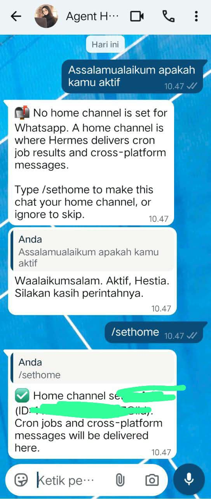

# Hermes Agent × WhatsApp

Menghubungkan **Hermes Agent** ke **WhatsApp** memakai bridge Baileys bawaan Hermes — dengan **pairing pakai kode 8 angka (tanpa scan QR)**, mode bot di nomor **WhatsApp Business** terpisah.

Hasil akhirnya: Hermes yang sama (otak/model, memori, dan skill yang sama) bisa di-chat lewat WhatsApp, berdampingan dengan pintu lainnya (mis. Telegram). WhatsApp di sini cuma *transport* — yang menjawab tetap Hermes.

> **Status:** teruji jalan penuh pada 23 November 2026 — pairing berhasil, gateway tersambung, pesan dari nomor utama dibalas Hermes lewat nomor bot.

---

## Arsitektur

```
Nomor utama kamu ──chat──▶ Nomor WA Business (nomor bot)
                                  │  (perangkat tertaut / companion)
                                  ▼
                        Bridge WhatsApp (Node.js + Baileys)
                        ~/.hermes/hermes-agent/scripts/whatsapp-bridge
                                  │  HTTP lokal (port 3000)
                                  ▼
                        Hermes Gateway (Python) ──▶ Model LLM
```

- Sesi WhatsApp (kredensial perangkat tertaut) disimpan di `~/.hermes/whatsapp/session`.
- Bridge dijalankan otomatis oleh gateway Hermes saat platform WhatsApp diaktifkan.
- Script `pair.mjs` di repo ini hanya dipakai **sekali** untuk pairing awal, menulis kredensial ke folder sesi yang sama persis dengan yang dipakai bridge. Setelah pairing, script ini tidak diperlukan lagi.

## Syarat

1. **Hermes Agent** sudah terpasang dan gateway-nya bisa jalan (panduan ini diuji pada Hermes Agent **0.22.5**).
2. **Node.js** (diuji dengan v24).
3. **Satu nomor khusus untuk bot**, sudah terdaftar aktif di WhatsApp — paling enak nomor kedua yang didaftarkan di **WhatsApp Business** (aplikasinya terpisah dari WhatsApp biasa, jadi bisa jalan barengan di satu HP).
4. Nomor utama kamu, untuk dimasukkan ke daftar izin (allowlist) dan dipakai mengobrol dengan bot.

> ⚠️ **Jangan pakai nomor WhatsApp utama sebagai nomor bot.** Jalur Baileys adalah jalur **tidak resmi** (di luar ketentuan WhatsApp) — risikonya nomor bisa dibatasi/diblokir permanen tanpa banding. Pakai selalu nomor cadangan khusus bot. Nomor utama tetap aman karena posisinya hanya sebagai *pengguna* yang mengobrol dengan bot.

## Langkah 1 — Pairing pakai kode (tanpa scan QR)

Pairing bawaan Hermes hanya menyediakan **scan QR**. Kalau kamu cuma pegang satu HP, QR di layar tidak bisa dipindai oleh HP yang sama. Solusinya: minta **kode pairing** ke server WhatsApp lewat script kecil, lalu ketik kodenya di aplikasi WhatsApp Business.

```bash
cd pairing
npm install
node pair.mjs 628xxxxxxxxxx   # nomor BOT (format internasional, tanpa +)
```

Script akan mencetak satu baris:

```
PAIRING_CODE:ABCD1234
```

Segera masukkan kode itu di HP (umurnya pendek):

1. Buka **WhatsApp Business** (akun nomor bot)
2. **Perangkat tertaut** → **Tautkan perangkat**
3. Pilih **"Tautkan dengan nomor telepon"**
4. Ketik kode 8 karakternya → konfirmasi → beri nama perangkat sesukamu

Setelah kode diterima, koneksi akan putus sekali dengan kode `515` (*restart required*) — **itu normal**, script menyambung ulang memakai kredensial yang baru tersimpan, lalu mencetak `CONNECTED:<nomor>@s.whatsapp.net`. Kredensial tersimpan di `~/.hermes/whatsapp/session` dan proses script berhenti sendiri.

## Langkah 2 — Aktifkan WhatsApp di Hermes

Tambahkan ke `~/.hermes/.env` (contoh lengkap ada di `.env.example`):

```ini
WHATSAPP_ENABLED=true
WHATSAPP_MODE=bot
WHATSAPP_ALLOWED_USERS=628xxxxxxxxxx
WHATSAPP_DM_POLICY=allowlist
```

- `WHATSAPP_MODE=bot` — nomor bot adalah nomor khusus yang di-chat orang (kebalikan dari `self-chat`).
- `WHATSAPP_ALLOWED_USERS` — **isi nomor utama kamu** (format internasional, tanpa `+`, pisahkan koma bila lebih dari satu). Hanya nomor ini yang dilayani Hermes; chat dari nomor lain ke nomor bot diabaikan. Ini kunci keamanan terpenting — tanpa ini, siapa pun yang tahu nomor bot bisa mengobrol dengan agen kamu.
- `WHATSAPP_DM_POLICY=allowlist` — DM hanya dari daftar izin.

Lalu (re)start gateway:

```bash
hermes gateway restart   # atau: hermes gateway run
```

Pada start pertama, gateway memasang dependensi bridge sendiri (`npm install` di folder bridge) dan menyambung memakai sesi hasil Langkah 1 — tidak perlu pairing ulang. Cek status:

```bash
hermes gateway status
# whatsapp → state: connected
```

## Langkah 3 — Tes

Dari **nomor utama** kamu, kirim chat apa saja ke nomor bot (mis. `halo`). Hermes akan menjawab dari nomor bot. Pesan pertama biasanya didahului pemberitahuan *home channel* — ketik `/sethome` sekali di chat itu agar hasil cron dan pesan lintas platform dikirim ke sana.

## Troubleshooting

| Gejala | Penyebab & obat |
| --- | --- |
| Kode pairing selalu ditolak HP: *"Gagal menautkan perangkat — periksa nomor telepon, atau dapatkan kode baru"* | Pendaftaran kode ditolak server WhatsApp dengan error IQ `400 bad-request`. Teramati pada **Baileys 7.0.0-rc13**: kodenya tercetak, tapi tidak pernah terdaftar di server. **Obat: lakukan pairing dengan Baileys 6.7.x** (repo ini mengunci `^6.7.24`). Sesi hasil v6 tetap bisa dipakai bridge rc13 untuk jalan sehari-hari. |
| `requestPairingCode failed: Connection Closed` | Kode diminta terlalu dini (timer tetap) sebelum server siap. Script di repo ini meminta kode saat event `qr` pada `connection.update` — momen server siap menerima pendaftaran kode. |
| Koneksi putus `515` tepat setelah kode diterima | Normal (*restart required* pasca-pairing). Sambung ulang dengan kredensial tersimpan; jangan hapus folder sesi. |
| Gateway: `whatsapp connect timed out after 30s` pada start pertama | Bridge masih memasang dependensi / sinkronisasi awal. Gateway menaruhnya di antrean retry latar belakang dan biasanya tersambung sendiri < 1 menit. Cek `~/.hermes/whatsapp/bridge.log`: cari `WhatsApp connected!`. |
| Pesan dari nomor utama tidak dibalas | Pastikan nomor di `WHATSAPP_ALLOWED_USERS` persis nomor pengirim (format `62…`, tanpa `+`/spasi), lalu restart gateway. |
| Perangkat tertaut hilang / bot logout | SIM nomor bot mati (lewat masa tenggang) atau WhatsApp Business tidak pernah dibuka > ±14 hari. Isi pulsa sebelum masa tenggang habis dan buka aplikasi Business sesekali. Ulangi Langkah 1 bila sesi sudah dicabut. |

## Keamanan

- **Jangan pernah commit** folder `~/.hermes/whatsapp/session` (berisi kredensial perangkat) atau file `.env` asli. `.gitignore` di repo ini sudah menutup pola-pola itu untuk salinan lokal.
- Allowlist nomor adalah lapis utama; perlakukan nomor bot sebagai nomor publik (siapa pun bisa mengiriminya pesan, tapi hanya nomor terdaftar yang dilayani).
- Jalur tidak resmi = risiko pemblokiran nomor bot selalu ada. Jangan jalankan bot di nomor yang menyimpan kontak/riwayat penting.

## Struktur repo

```
.
├── README.md        # panduan ini
├── pairing/
│   ├── pair.mjs     # script pairing kode (Baileys 6.7.x), dipakai sekali
│   └── package.json
├── .env.example     # contoh konfigurasi gateway Hermes untuk WhatsApp
└── LICENSE
```

## Versi yang diuji

- Hermes Agent 0.22.5 (bridge WhatsApp bawaan, Baileys 7.0.0-rc13 saat runtime)
- Pairing: Baileys 6.7.24, Node.js 24
- Model yang menjawab saat pengujian: GLM-5.3-Flash (konfigurasi model Hermes tidak berubah oleh panduan ini — WhatsApp hanya pintu masuk tambahan)

## Lisensi

MIT — lihat `LICENSE`.

## Bukti: Hermes Aktif di WhatsApp

Screenshot chat dengan bot Hermes (Agent Hestia) di WhatsApp: bot menjawab sapaan dan perintah /sethome berhasil dipasang.


